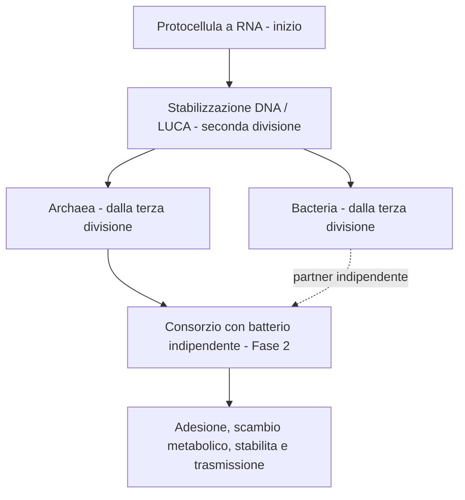

# Mutazioni, risorse e sviluppo cellulare — 12 novembre 2026

## Stato raggiungibile

La partenza non e un batterio moderno. Bacteria e Archaea sono rami distinti. La Fase 2 arriva ad associazioni procariotiche: non sono implementati nucleo, mitocondri, endosimbiosi compiuta, FECA o LECA. Le tappe DNA/LUCA e separazione dei rami sono eventi di campagna, non acquisti subordinati al contatore di cinque puntiformi. LUCA e l'ultimo antenato comune universale, non la prima forma di vita. Fonte primaria: [Moody et al., 2024](https://www.nature.com/articles/s41559-024-02461-1). Le ricostruzioni storiche non definiscono una sagoma cellulare certa.

## Regole implementate

- 240 nodi puntiformi: pallini colorati, acquistabili liberamente nella categoria, senza catene di prerequisiti. Costo 1 punto.
- 48 scelte maggiori: icone disegnate in codice, 8 per categoria; rappresentano livelli e combinazioni di 9 loci comuni, non 48 strutture biologiche distinte. Il genoma completo ha 16 loci, inclusi eventi di campagna e specializzazioni di ramo.
- Ogni maggiore costa 2 punti e richiede 5 ulteriori puntiformi della stessa categoria: 5, 10, 15, ... 40. Acquistare solo nodi maggiori non aggira il requisito. Loci al massimo non sono acquistabili.
- Eccezione iniziale: idrolasi extracellulari acquistabili con i 2 punti della prima divisione (GEN 1). Questa maggiore conta nel totale della categoria: per la successiva servono 10 puntiformi.
- Le varianti casuali ereditarie accumulano un contatore separato: ogni 5 eventi puntiformi generano un locus maggiore eleggibile, dalla generazione 2. Le tappe di campagna restano separate.
- Le maggiori aggiornano il genoma e i moduli 3D ereditabili; le puntiformi modificano le statistiche.

La distinzione piccolo/grande e la soglia di cinque sono convenzioni di gameplay. In biologia una mutazione puntiforme puo avere effetti importanti; l'evoluzione non segue un contatore obbligatorio di innovazioni.

## Limiti e compromessi

| Categoria | Limite | Malus associato nell'albero |
|---|---:|---|
| Mobilita | 1,60 | metabolismo |
| Attacco | 1,90 | assorbimento |
| Difesa | 1,85 | mobilita |
| Propensione mutazioni | +0,35 (minimo -0,20) | difesa |
| Metabolismo | 1,80 | attacco |
| Assorbimento | 1,80 | difesa |

Le statistiche ordinarie non scendono sotto 0,65. Bonus iniziale puntiforme +0,025, maggiore +0,08; malus rispettivamente -0,004 e -0,012. I guadagni positivi vengono moltiplicati per `(limite-valore)/(limite-base)`, limitato a 0..1: rendimenti decrescenti, mai superamento del tetto. I vecchi salvataggi conservano acquisti/geni, ma i valori numerici fuori scala vengono ricondotti nei limiti.

Velocita iniziale 2,3868 unita/s; tetto del giocatore con motore 4,896 unita/s, circa 2,05 volte la partenza. La specializzazione veloce riduce il metabolismo e aumenta fino al 30% il costo energetico per distanza. Proteasi e trasportatori aggiungono un piccolo mantenimento.

## Bilancio energetico e risorse

| Voce | Prima | Ora |
|---|---:|---:|
| Mantenimento base ATP/s | 0,28 | 0,10 |
| ATP per unita percorsa, metabolismo base | 0,55 | 0,18 |
| Consumo a velocita iniziale ATP/s | 1,593 | 0,530 |
| Autonomia con 66 ATP senza raccolta, movimento continuo | circa 41 s | circa 125 s |
| Carbonio generato | 25% | 6/14, circa 43% |
| Carbonio iniziale | 21/84 | 36/84 |
| Enzima / lisi ATP per attacco | 9 / 15 (HUD incoerente) | 6 / 10 (HUD coerente) |

Carbonio assimilato: 6 ATP moltiplicati per la radice del metabolismo; altre molecole 0,75 ATP, detrito 3 ATP. Rimangono lipidi, amminoacidi e nucleotidi: il carbonio e una risorsa energetica astratta, non ogni composto carbonioso e necessariamente zucchero.

Predazione riuscita: C10, AA7, lipidi4, nucleotidi3, biomassa12, ATP18, oltre ai detriti rilasciati. I guadagni di risorse rispettano assorbimento e capacita delle riserve; ATP18 non dipende dall'assorbimento. Il premio scatta una sola volta alla morte, anche per predatori NPC.

Substrati: 6 conglomerati locali, ciascuno con 3 porzioni. Gli enzimi li selezionano entro 10 unita e si avvicinano fino a 1,55. Ogni digestione costa 6 ATP, restituisce C6/AA3/lipidi2/nucleotidi1/biomassa4/ATP8, con 2 s di ricarica. Non vengono raccolti passivamente. Nuovi conglomerati compaiono dopo 20 s se sotto il limite; quelli lontani vengono riallocati durante l'esplorazione. Porzioni e timer sono salvati; i salvataggi precedenti ricevono i substrati iniziali.

## Tutte le 30 varianti casuali

Valori prima dei rendimenti decrescenti e dei limiti. La scala dei vecchi effetti e ridotta al 35%; la fedelta di replicazione abbassa la propensione alla mutazione, quindi un segno negativo puo essere un beneficio strategico. Alcune varianti danno due piccoli benefici, altre un compromesso: non tutte devono essere equivalenti.

| Variante | Effetto principale | Effetto secondario |
|---|---|---|
| Efficienza di trasporto | uptake +0.0315 | metabolism -0.0105 |
| Membrana rinforzata | defense +0.0420 | motility -0.0175 |
| Mobilita amplificata | motility +0.0420 | metabolism -0.0245 |
| Idrolasi extracellulari | attack +0.0420 | metabolism -0.0175 |
| Catabolismo efficace | metabolism +0.0420 | defense -0.0105 |
| Replicazione piu fedele | mutation -0.0210 | metabolism -0.0070 |
| Mutatore transitorio | mutation +0.0455 | defense -0.0175 |
| Rivestimento flessibile | motility +0.0280 | defense -0.0350 |
| Proteasi specializzate | attack +0.0560 | metabolism -0.0280 |
| Scambio superficiale | uptake +0.0385 | defense -0.0175 |
| Chaperoni | defense +0.0245 | metabolism -0.0105 |
| Adesione reversibile | defense +0.0210 | motility -0.0140 |
| Proteostasi | defense +0.0315 | uptake -0.0140 |
| Regolazione dell'ATP | metabolism +0.0350 | uptake -0.0175 |
| Secrezione ridotta | metabolism +0.0210 | attack -0.0455 |
| Pori di membrana | uptake +0.0350 | defense -0.0210 |
| Curvatura cellulare | uptake +0.0210 | defense -0.0140 |
| Dissipazione termica | defense +0.0280 | metabolism -0.0140 |
| Turnover lipidico | defense +0.0315 | uptake -0.0105 |
| Metabolismo parsimonioso | metabolism +0.0315 | motility -0.0280 |
| Segnale di chemotassi | motility +0.0245 | metabolism -0.0105 |
| Membrana porosa | uptake +0.0420 | defense -0.0280 |
| Parete compatta | defense +0.0490 | motility -0.0280 |
| Molecole adesive | defense +0.0175 | uptake +0.0105 |
| Proteasi ad ampio spettro | attack +0.0315 | uptake +0.0105 |
| Accrescimento lento | defense +0.0245 | motility -0.0105 |
| Risposta redox | metabolism +0.0280 | defense +0.0070 |
| Riparazione accurata | mutation -0.0280 | metabolism -0.0140 |
| Elevata variabilita | mutation +0.0420 | defense -0.0140 |
| Variante quasi neutra | uptake +0.0028 | motility -0.0021 |

## Verifica e limiti

17 smoke test Godot e 113 controlli statici superati. Il nuovo test verifica stacking estremo, bilancio ATP, carbonio iniziale, acquisto enzimi in GEN1, digestione/cooldown/esaurimento/respawn, bottino unico e salvataggi nuovi/precedenti. Screenshot autentici: `build/previews/mutation-tree.png` e `organic-substrate.png`.

Questi valori costituiscono un primo bilanciamento verificato nel codice: non sostituiscono una sessione prolungata su smartphone. Il catalogo non implementa ancora sviluppo eucariotico. I moduli sono stilizzazioni visive, non ricostruzioni molecolari in scala.
